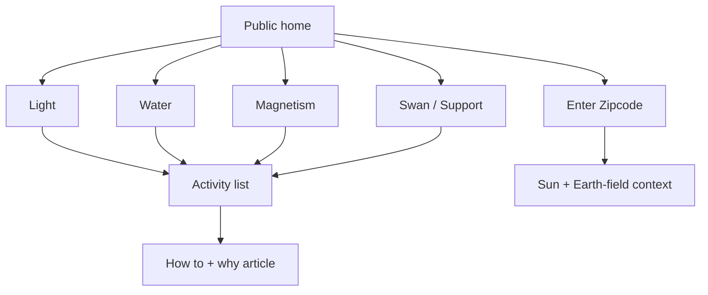

# Mitochondriapp design

## Product direction

Mitochondriapp is a quiet public reference for practical mitochondrial
lifestyle activities. It deliberately removes identity, progress, and
dashboard mechanics so the content is the product.

The visual anchor is a black swan. The swan opens **Support** activities:
sleep, cold, movement, and other practices that do not belong directly to the
three environmental pillars. Three orbiting controls open **Light**, **Water**,
and **Magnetism**. A small **Where you are** control beneath the swan opens
ZIP-powered context.

## Interaction model

There are no menus, account links, bottom navigation, tours, or dashboard
routes. All content opens in one accessible dialog flow. Selecting an activity
replaces the list inside the same dialog with its how-to and article.

## Content model

`content/public-content.json` is the runtime source of truth:

- `activities` contains stable ids, names, descriptions, pillar assignment,
  how-to copy, equipment guidance, optional approaches, and an article id.
- `articles` contains title, summary, pillar, and readable sections.
- Tracker-only fields such as points, durations, completions, and auto-log flags
  are not part of the public runtime model.

The bundle was materialized from the previous seed and article content before
the database and tracker runtime were removed. Future editorial changes should
edit the bundle and article files directly, then run the normal checks.

## Place context

The place dialog accepts a US ZIP code and calls `/api/place`. The request is
ephemeral: no ZIP, account, cookie, or database row is created. The response
combines:

- latitude, longitude, place name, and timezone from public geocoding;
- local sunrise, sunset, solar noon, and day length;
- latitude and seasonal-light labels;
- best-effort elevation;
- main geomagnetic field values with a fallback model;
- geology and nearest-volcanic-anchor context;
- best-effort infrastructure/artificial-EM context.

The result is stored only in component state. The last ZIP may be remembered in
browser local storage to make returning to the dialog convenient.

## Visual language

- dark, warm, sparse, and low-blue;
- amber as the single accent;
- flat surfaces with restrained glow and a thin orbital ring;
- no card-heavy dashboard layout;
- controls remain at least 44px for touch and keyboard use;
- reduced-motion users receive the same information without functional motion.

The fixed disclaimer uses safe-area padding and the home composition reserves
space above it so it cannot cover the orbital controls.

## Accessibility

- pillar, swan, and place controls are real buttons with labels;
- dialogs expose headings, `aria-modal`, Escape close, focus restoration, and
  background scroll locking;
- ZIP errors use an alert and place results use a live region;
- activity/article copy remains readable at mobile widths;
- focus-visible outlines use the amber accent.

## Non-goals

This application does not create accounts, store user activity, award points,
maintain schedules, send reminders, show leaderboards, offer admin editing, or
connect to Neon, Drizzle, Auth.js, or Vercel cron.
